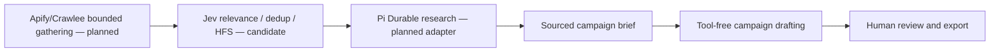

# Disler multi-agent tools

Checked 21 October 2026. IndyDevDan's **[My Jev Pi Durable Agent CURATES News: HYPE, FACT, or SIGNAL](https://www.youtube.com/watch?v=OLqP8jxJ0Wc)**, published 20 October, links directly to [pi-durable-news-agent](https://github.com/disler/pi-durable-news-agent/tree/273b79bb8d3d8907cae9fbd6abd3da163ee2a343). Its architecture separates gathering, relevance/worth gates, story deduplication, ranking, research and presentation. Those are useful inputs to our audience/campaign workflow.

| Component | Current role | Connection |
| --- | --- | --- |
| Disler durable-pi | Existing authenticated HTTP/SSE device integration | Local, core upgraded to 1.1.0; [qualification](CORE-UPGRADE.md) |
| Disler pi-durable-news-agent | Reference for bounded research and content discovery | Researched, not connected |
| News-agent `durable-agent` workspace package | Harness built on Earendil pi-durable/pi-ai/chord 1.1.0 | Reference, not imported |
| News-agent `jev` workspace package | Repository-local classifier client and decision policies | Reference; requires separate hosted inference access |

Both Disler applications depend on Earendil packages. The new repository is not marked as a GitHub fork; this alone does not establish independent code ancestry. We have not asserted that it descends from our pinned durable-pi commit. The installed core packages identify [earendil-works/pi](https://github.com/earendil-works/pi) as their source. Jev wrapper code is distinct from the hosted model: TypeSafe and OpenRouter are external service endpoints, and `jev-latest` is a moving model alias rather than a reproducible model pin.

Pi stays the single execution/recovery authority. Candidate Jev scores are suggestions, not factual proof or authorization to spend, execute tools or publish. Static permissions and human review remain authoritative. Convex remains the future shared-data layer. Adding this research entry does not activate cron sweeps or connect inference credentials.

The [machine-readable tool map](integrations/disler/tools.json) records pins and connection states. The news-agent's [MIT notice](integrations/disler/NEWS_AGENT_LICENSE) is retained. No runtime code from it is bundled. Its older educational `ten-levels-of-jev` examples remain separate research; their names do not establish identical safety behavior.
