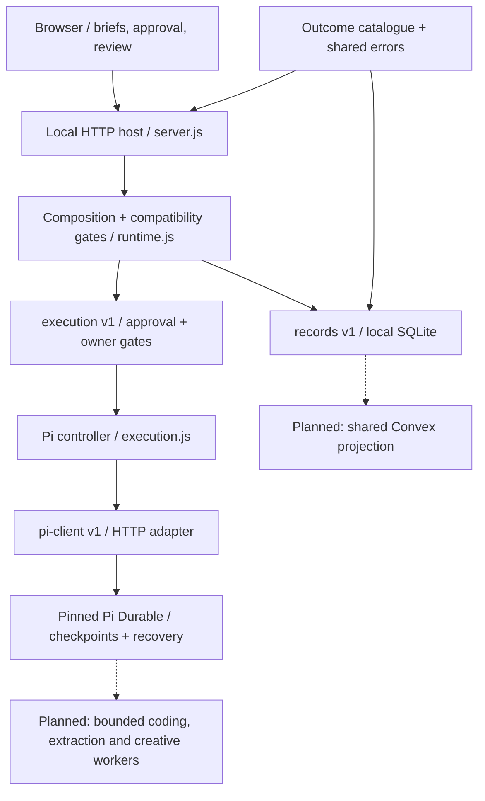

# Replaceable components

The current system is a small modular application, with explicit contracts rather than dynamically downloaded plugins. Pi Durable owns execution recovery. Local SQLite owns the current workspace records. Convex is the planned shared application-data layer; it is not a second execution scheduler.

## Running structure



| Component | Responsibility | Replacement boundary |
| --- | --- | --- |
| `catalogue.js` | Five outcomes, review controls and aesthetic choices | No persistence, provider or framework imports |
| `contracts.js` / `errors.js` | Version checks, identity, safe connection shape and shared errors | No network or database access |
| `store.js` | Persistent records, approval transactions, retry identities and run projection | `records` contract v1; synchronous local API |
| `execution.js` | Pi session admission, recovery, status and confirmed cancellation | `execution` contract v1; uses the Pi-client port without importing its implementation |
| `pi-client.js` | Qualified Pi HTTP protocol, authentication and workspace allocation | `pi-client` contract v1; no application database access |
| `runtime.js` | Creates and validates modules, enforces common gates, reports capabilities | Explicit factory injection; one selected execution service |
| `server.js` | Loopback HTTP, input/origin checks, public responses and local CLI wiring | Existing HTTP routes retained; `GET /api/system` added |
| `launch-site/` | Public-facing Assembly study and its own local signup data | Separate service, dependencies and approval; no agent dispatch routes |

`tests/boundaries.test.js` scans source imports with the [documented Bun transpiler](https://bun.com/docs/runtime/transpiler#scan) and rejects dependencies outside these reviewed boundaries. This checks literal imports, not computed runtime loading or malicious module behavior. New modules require an explicit boundary decision.

## Contracts at version 1

Each module exposes `module: { id, kind, contractVersion: 1 }`. IDs are validated strings. Execution modules also expose a stable `runOwner`, such as `pi-durable/v1`. This is a **run-identity protocol version**, not a package version. Use the same owner for compatible upgrades; use a new owner for incompatible identities or state semantics. Constructors reject missing methods and unsupported contract versions before serving requests.

### Records

The synchronous records port implements:

```text
create(input, requestKey) -> { project, replayed }
project(id), list(), events(projectId)
saveCreative(id, input), approveCreative(id, input), review(id, control, input)
checkApproval(id, revision) -> approved project or InputError
run(id), latestRun(projectId)
reserveRun(projectId, revision, deviceUid, model, workspace, executionOwner)
updateRun(id, fields), close()
```

Required semantics: atomic approval/revision checks; idempotency-key conflict detection; one run per project/revision; one active run per project; immutable execution owner; persistent upstream identities; and transactions for reservation/status updates. `workspace(projectId, revision)` is a supplied directory allocator. Errors retain stable HTTP status semantics. `close()` releases owned storage resources.

A future network-backed store is **not** a drop-in replacement for this synchronous contract. Start Convex as an asynchronous shared-data projection with project isolation, replay and reconstruction checks. An authoritative async store requires an explicit new records contract and coordinated caller migration. Do not fake synchronous network calls or run competing schedulers.

### Execution service

```text
connection() -> Promise<Connection>
dispatch(projectId, { revision }) -> Promise<Run>
refresh(projectId) -> Promise<Run | null>
abort(projectId, displayedRunId) -> Promise<Run>
```

`Connection` contains `status` and `detail`. When `CONNECTED`, it must also contain `uid`, `deviceName` and `model: { id, provider, name }`. Only these fields are returned by the runtime connection wrapper. Connection success is not a model-completion or artifact-verification claim.

The runtime rechecks creative approval and run ownership before entering a replacement executor. The Pi controller independently enforces those gates for direct callers. New executors must preserve stale-stop protection, idempotency, ambiguous-admission recovery and confirmed cancellation semantics; a shape check alone cannot prove these behaviors. Terminal answers remain evidence for review, not automatic publication permission.

### Pi client

The Pi-specific port implements `connection`, `device`, `workspace`, `findSession`, `lookupSubmission`, `createSession`, `configure`, `send`, `submission`, `withdraw` and `abort`. The pinned device API, durable version and recovery extension remain checked on the wire. An OpenCode or Cloudroom adapter must not impersonate this protocol; implement an execution service or a bounded Pi worker instead.

## Run ownership and upgrade safety

Every persisted run has an `executionOwner`. Existing databases gain an additive `execution_owner` column defaulting to `pi-durable/v1`, because all earlier releases wrote Pi runs. Existing session IDs, submission IDs, results, approval records and project IDs are preserved. Tests remove the column from a fixture representing the prior schema, then reopen it twice to verify migration and restart behavior.

A foreign owner causes `EXECUTION_OWNER_MISMATCH` (409) before execution-service traffic or run mutation. Existing Pi device-UID checks still prevent device replacement from receiving old runs. A new engine may start a genuinely new approved revision after the previous run is terminal; it cannot silently take over that run. No automatic transfer or dual execution is provided.

Before an incompatible replacement: retain a private consistent checkpoint, finish or confirm cancellation of active work, reconcile durable identities, then qualify the replacement against an isolated fixture. Restore the original owner to continue an old run. Restore source and data together for rollback if schema compatibility is uncertain; a Git revert alone is not a database recovery plan.

## Selecting implementations

Trusted application code can call:

```js
startServer({
  port: 0,
  database: ":memory:",
  recordsFactory: openStore,
  executionFactory: createExecution,
  pi: configuredPiClient,
});
```

Factories are selected in code at startup. They are not accepted from HTTP input, arbitrary package names or user-submitted URLs. Constructors are synchronous; execution operations are async. A failed execution constructor/contract or failed server bind closes the records handle. Modules run with the host's privileges; injection is not a plugin sandbox. Replacing a module requires a controlled restart, not a live mutation during a run.

`GET /api/system` returns allowlisted module IDs, kinds, contract versions, execution owner and status. It omits factories, tokens, URLs, paths, account details and arbitrary module fields. It uses the same loopback/same-origin controls as the rest of the app. The planned entries remain `NOT_CONNECTED` until actual adapters are qualified.

## Qualification and next integrations

1. Existing local briefs → creative approval → Pi execution → saved evidence remains the first working path.
2. Add shared Convex projections after credentials/project isolation are configured; retain Pi execution authority.
3. Qualify one bounded extraction worker using Crawlee/Scrapling, with source provenance and replayable receipts. Activepieces Community owns bounded connector jobs, not the top-level workflow.
4. Qualify Cloudroom/OpenCode coding workers after their runtime failures and cleanup behavior are resolved.
5. Add creative/Blender and social/distribution adapters one destination at a time, with explicit release approval and reconciliation after ambiguous sends.

No new third-party services were installed or provisioned by this slice. The contract tests, import checks, existing app tests and launch-site tests run in `bun test`. The [module compatibility workflow](.github/workflows/module-check.yml) pins Bun 1.4.3 and action commits, retains lint/build checks and installs the existing launch dependency from its frozen lockfile with scripts disabled. [Bun's CI guide](https://bun.com/guides/runtime/cicd) documents the setup action; its exact resolved commit is pinned in the workflow.
