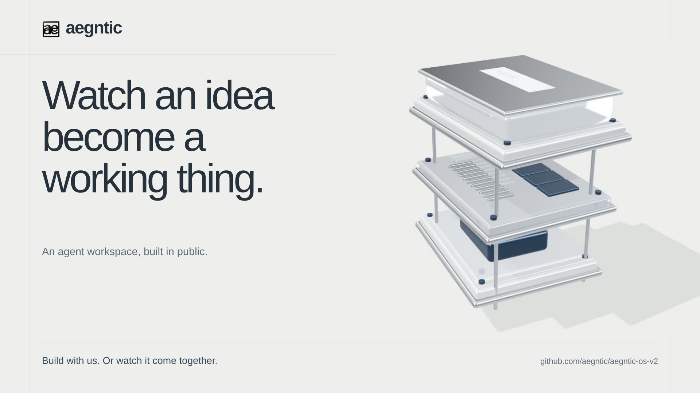
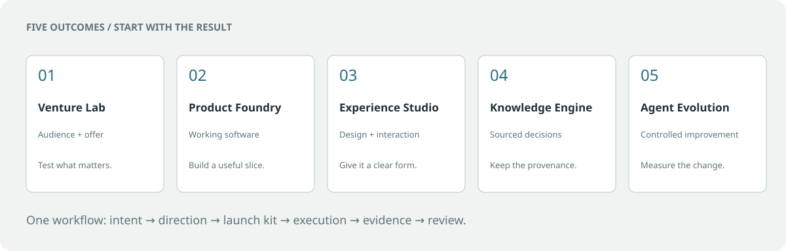
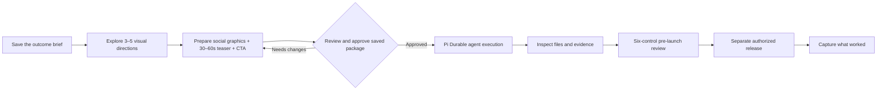
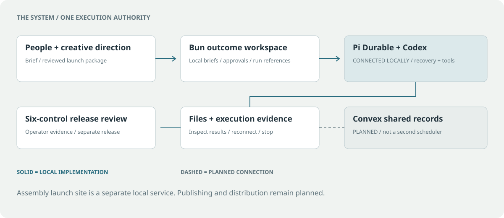
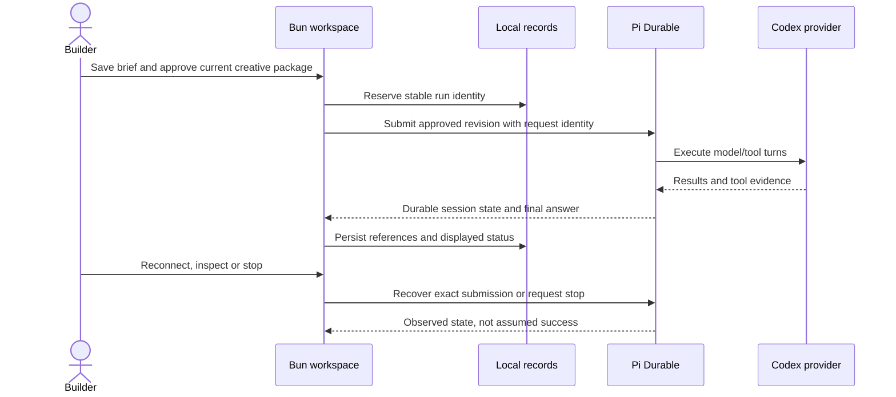
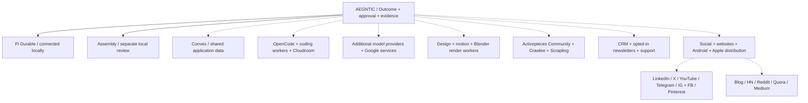
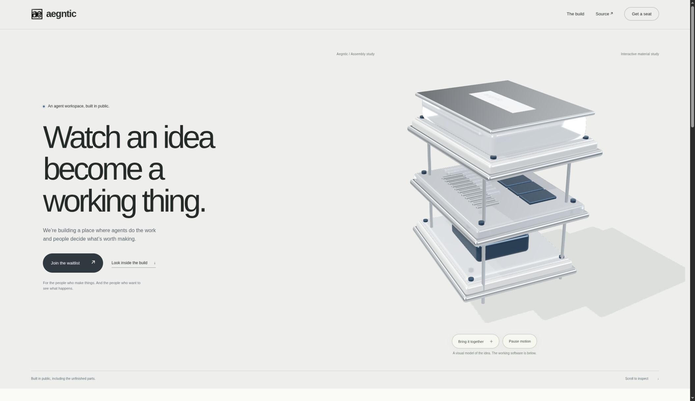
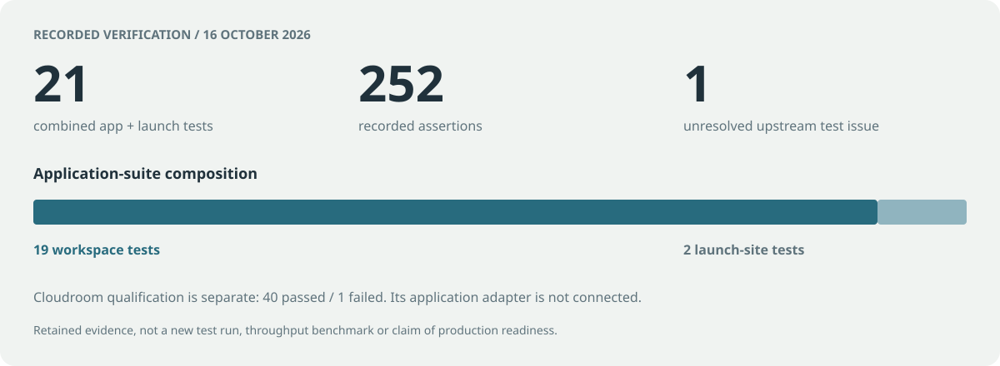
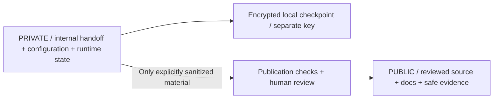

<div align="center">

# Aegntic OS V2

### Multi-agent work. Human direction. Evidence you can open.

[](launch-site/README.md)

   

**[Start locally](#start-locally) · [System map](#the-system-map) · [What works](#what-works-today) · [Follow the build](BUILD-LOG.md) · [Private continuity](#private-continuity)**

</div>

**Aegntic is a local multi-agent outcome workspace that turns a brief into reviewed work and inspectable evidence.** It combines five outcome families, creative approvals, Pi Durable execution through an existing Codex sign-in, persistent records and a six-control pre-launch review. A separate Three.js Assembly site explores the public launch experience.

**Core updated — 21 October 2026:** Pi Durable / pi-ai / chord 1.1.0; [upgrade and recovery evidence](CORE-UPGRADE.md), [Disler tool map](DISLER-TOOLS.md).

**Application baseline — 17 October 2026:** trusted local execution is connected. The launch site is a local review. Convex, external publishing and mobile distribution remain planned. Source is public; operational state and private continuation stay outside the published checkout.

## From an idea to something real



| Your intent | Workspace | Useful result |
| --- | --- | --- |
| Find a worthwhile problem | **Venture Lab** | Audience, offer and a validation plan |
| Build a useful product | **Product Foundry** | A working slice with observed behavior |
| Make the experience distinctive | **Experience Studio** | Visual direction and usable interactions |
| Reach a defensible decision | **Knowledge Engine** | Sourced findings with provenance |
| Improve the agent workflow | **Agent Evolution** | A bounded experiment with evidence |

The workspace offers these outcome families. It does not claim that every specialized worker or evaluator behind them is implemented.



## The system map



**Pi Durable owns execution and recovery.** The Bun host owns local briefs, creative approval records and run references. Convex is the preferred future shared application-data backend, without introducing a competing workflow authority.

<details>
<summary>Explore the execution and recovery flow</summary>



[Read the runtime, provider and recovery contract →](EXECUTION.md)

</details>

### Upgradeable parts

The host now validates versioned records, execution and Pi-client contracts. A central runtime selects implementations; saved runs retain their execution owner, and incompatible replacements are rejected before backend traffic. Import-boundary tests and a pinned CI workflow guard these seams. [Component map, contracts and replacement procedure →](MODULES.md)

Inspect the running component status at `GET /api/system`. The modular qualification passed **32 tests / 328 assertions** on 17 October 2026. [Qualification evidence →](artifacts/product-foundry/modular-runtime/evidence.md) Convex and the other planned services remain explicitly unconnected.

## What works today

| Capability | State | Evidence / next boundary |
| --- | --- | --- |
| Five outcome briefs, persistence and replay protection | **Working locally** | [First-run evidence](artifacts/product-foundry/first-run/evidence.md) |
| Creative package approval and stale-revision protection | **Working locally** | [Creative kickoff](CREATIVE-KICKOFF.md) |
| Pi Durable + existing Codex sign-in | **Connected locally** | [Real execution qualification](artifacts/product-foundry/agent-execution/evidence.md) |
| Start, reconnect, refresh, stop intent and final results | **Working locally** | [Execution contract](EXECUTION.md) |
| Assembly scene, local waitlist/removal and sharing | **Local review** | [Launch-site evidence](launch-site/evidence/checks.json) |
| Social graphic masters and silent Assembly teaser | **Review drafts** | [Creative package](launch-site/README.md#creative-review-package) |
| Convex shared application data | **Not connected** | Configuration and project isolation required |
| Cloudroom coding-worker adapter | **Not connected** | [Separate qualification: one unresolved upstream failure](CLOUDROOM-QUALIFICATION.md) |
| Google, automation, extraction and creative workers | **Planned** | Bounded adapters and observed receipts required |
| Social publishing, CRM/newsletters and app stores | **Planned** | [Business services](BUSINESS-SERVICES.md) and provider qualification |
| Memory services and controlled harness evolution | **Research** | [Tencent / SelfSearch assessment](MEMORY-AND-EVOLUTION.md) |

**One trusted local user:** the worker has the current user's filesystem privileges. Its working directory is not an OS sandbox. A model answer or operator review is not an independently verified release.

## The ecosystem map

The diagram maps intended adapter families. Dashed connections are planned, not currently integrated services.



Platform access, supported APIs and publication approval are checked per destination. A place on this map is not a claim that an API or publisher is available. GBrain is excluded. Suitable new systems services favor Rust; compatible new host/tooling code favors Bun; standalone Python work favors Astral uv. celld is a candidate for compatible self-hosted services on infrastructure we control.

## Assembly / the public face

<table>
<tr>
<td width="64%"></td>
<td width="36%"><strong>Bright architectural. Deliberately tactile.</strong><br><br>Assembly was selected on 16 October 2026. It uses a procedural Three.js scene, readable editorial typography and neutral glass/chrome materials.<br><br>Local signup/removal, sharing and four social-master sizes are prepared. Final graphics, teaser and deployment approval remain separate.<br><br><a href="launch-site/README.md">Explore Assembly →</a></td>
</tr>
</table>

Amber belongs to Clawreform. Aegntic uses paper, obsidian, silver and restrained cool accents. [Four earlier hero/layout studies](artifacts/product-foundry/hero-layouts/handoff.md) document the exploration.

### Watch the review cut

[](launch-site/creative/AEGNTIC-assembly-45s-review.mp4)

**[Download the 45-second Assembly review cut](launch-site/creative/AEGNTIC-assembly-45s-review.mp4)** — 1920×1080, 24 fps, caption-led and silent. This is review artwork, not a live agent stream or approved public release.

A separate earlier seven-scene explainer includes Kokoro narration, music and subtitles. That media package remains outside this Git repository in the operator's workspace; it is not exposed through broken sibling links here. Its narration predates connected execution. [Media provenance](THIRD_PARTY_NOTICES.md#narration-and-video-production) records the distinction.

## Evidence, not progress theater



These are retained results from **16 October 2026**, not newly rerun tests or a throughput benchmark. The combined app/launch suite includes 19 workspace tests and two launch-site tests. Cloudroom qualification is separate: 40 passed and one disk-pressure writer-selection test failed. The Cloudroom app adapter remains unconnected.

| Record | What you can inspect |
| --- | --- |
| [Build log](BUILD-LOG.md) | Dated changes and observed checks |
| [Execution evidence](artifacts/product-foundry/agent-execution/evidence.md) | Real provider/filesystem qualification in an isolated fixture |
| [Launch-site checks](launch-site/evidence/checks.json) | WebGL, controls, mobile layout, synthetic signup/removal and sharing |
| [Roadmap](ROADMAP.md) | Working, qualified, researched and planned boundaries |

## Start locally

### Outcome workspace

Requires **Bun 1.4.3+**. The new Bun host uses built-in HTTP and SQLite APIs without external runtime packages.

```sh
bun start
```

Open **http://127.0.0.1:4317/**. To run the configured workspace and upstream Pi backend together:

```sh
bun run start:connected
```

[EXECUTION.md](EXECUTION.md) documents the pinned upstream checkout, original npm lockfile, provider patch, private configuration and recovery. The Node/npm backend has separate dependencies. Existing Codex sign-in stays managed by Codex; credentials never belong in browser data or Git.

### Assembly launch-site review

```sh
cd launch-site
bun install --frozen-lockfile --ignore-scripts
bun run build
bun start
```

Open **http://127.0.0.1:4320/**. This service has separate local waitlist storage and no agent-dispatch routes. It sends no email. Public deployment and production signup handling require their own configuration and approval.

### Verification commands

```sh
bun run lint
bun test
bun run build
python3 -m unittest discover -s tests -p 'test_publication.py' -v
python3 scripts/check_publication.py --mode index
python3 scripts/check_publication.py --mode history
```

Bundling checks and supplemental Oxlint remain in the workflow. Browser checks use a separately available Playwright installation and create labelled synthetic fixtures. No existing checks were removed.

## Private continuity

**The private workspace is separate from this public README.** This section contains public operating instructions only. Markdown comments, `<details>` sections, diagrams, images and Git history are not private storage.



Private continuation stays outside the published checkout. The operator's protected handoff preserves decisions, restart context, private paths and encrypted checkpoint recovery. Its contents, location and decryption material are not committed here.

The current clone has publication hooks enabled. Other clones can enable the reviewed hooks with:

```sh
git config --local core.hooksPath .githooks
```

The checks reject selected private paths, database/key/bundle files and credential markers, including detected credentials in history. They never print matched values. They are defense in depth, not a guarantee that every sensitive sentence or unknown token format is detected. [Read the full public/private boundary and recovery procedure →](docs/PRIVATE-WORKFLOW.md)

## Frequently asked questions

### What is Aegntic OS V2?

Aegntic OS V2 is a local multi-agent outcome workspace for briefs, creative approval, durable agent execution and pre-launch evidence. Pi Durable runs approved work through an existing Codex sign-in. The app keeps the records and evidence needed to reconnect, inspect and review it.

### What is actually connected?

Pi Durable/Codex execution is connected locally. The Assembly launch-site review is a separate local service. Convex, the Cloudroom application adapter, additional providers, external publishing and mobile distribution remain unconnected.

### Can I self-host it?

You can run the current services on loopback as a trusted local development setup. They are not qualified multi-tenant public services. The backend runtime, provider terms and pending project license must be reviewed before a different deployment or distribution.

### Is this open source?

Yes. Original Aegntic software and associated documentation in this repository are available under the [MIT License](LICENSE). Personal and commercial use are free at any revenue or user count. Keep the Aegntic copyright and full MIT notice in copies or substantial portions of the software, alongside applicable third-party notices. A visible “Built with Aegntic” credit and repository link are appreciated, but are not additional license conditions. [License scope and attribution →](LICENSING-STATUS.md)

### Where do data and credentials live?

Local runtime records live in ignored private storage. Account sign-in remains with its owning client; operational continuity and checkpoints stay outside the public checkout. The public repository does not contain a private account or continuation area.

### Does this promise search rankings or AI citations?

No. The README supplies clear project facts, status, evidence, diagrams and direct answers. [Search/GEO notes](docs/seo/DISCOVERABILITY.md), [public facts](project-facts.json) and [the optional agent-readable index](llms.txt) explain what is provided. GitHub controls its page metadata; no custom README meta tags, geographic coordinates or undeployed website schema are claimed.

## Follow the work

**[Read the build log](BUILD-LOG.md) · [Inspect the roadmap](ROADMAP.md) · [Open an issue](https://github.com/aegntic/aegntic-os-v2/issues) · [Review execution](EXECUTION.md)**

Preserve [third-party attribution](THIRD_PARTY_NOTICES.md), exact upstream notices and lockfiles. The Aegntic MIT license does not relicense upstream code or grant trademark rights. Private research, subscriber records, account credentials and continuation files are excluded from public publication.
